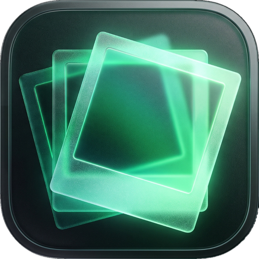

<p align="center">
  
</p>

<h1 align="center">Lumina</h1>

<p align="center">
  <b>Your memories, illuminated.</b><br>
  A blazing-fast, privacy-first, gesture-driven Android gallery built 100% with Kotlin & Jetpack Compose.
</p>

<p align="center">
  
  
  
  
  
  <a href="https://github.com/initeshjain"></a>
</p>

---

## Table of Contents

- [Overview](#overview)
- [Key Features](#key-features)
  - [1. Pictures — Smart Timeline & Instant Search](#1-pictures--smart-timeline--instant-search)
  - [2. Albums & Collections](#2-albums--collections)
  - [3. Swipe Tidy — Interactive Deck Sorting](#3-swipe-tidy--interactive-deck-sorting)
  - [4. Media Viewer & Gesture Controls](#4-media-viewer--gesture-controls)
  - [5. Advanced Video Player](#5-advanced-video-player)
  - [6. EXIF Details & Metadata Privacy Stripper](#6-exif-details--metadata-privacy-stripper)
  - [7. Clean Up Assistant — Duplicate & Redundancy Scanner](#7-clean-up-assistant--duplicate--redundancy-scanner)
  - [8. Trash Bin & Single-Prompt Deletion](#8-trash-bin--single-prompt-deletion)
  - [9. Themes & Modern Aesthetics](#9-themes--modern-aesthetics)
- [Privacy & Security Commitment](#privacy--security-commitment)
- [Architecture & Tech Stack](#architecture--tech-stack)
- [Building & Installation](#building--installation)
  - [Prerequisites](#prerequisites)
  - [Build Debug APK](#build-debug-apk)
  - [Build Release APK](#build-release-apk)
  - [Sign the Release APK](#sign-the-release-apk)
- [Author & Acknowledgments](#author--acknowledgments)

---

## Overview

**Lumina** is designed as a modern replacement for bloated, ad-ridden gallery apps. Built from the ground up using **Jetpack Compose** and **Material 3**, Lumina offers a fluid 120Hz browsing experience, responsive gesture navigation, and robust tools to declutter your photo library.

Most importantly, Lumina operates **100% offline**: the app does not request or possess the `android.permission.INTERNET` permission. Your personal photos, videos, and metadata never leave your physical device.

---

## Key Features

### 1. Pictures — Smart Timeline & Instant Search

The primary **Pictures** tab organizes your visual life with smart contextual timeline groupings and instant search:

- **Friendly Date Headings**: Automatically formats dates into natural language:
  - *Today*
  - *Yesterday*
  - *26 May* (current year)
  - *26 May 2023* (previous years)
- **Top Timeline Pills**: Switch between timeline zoom levels with a single tap:
  - `Days`: Micro-level grouping by day.
  - `Months`: Mid-level grouping by month (e.g. *May 2024*).
  - `Years`: High-level overview by year (e.g. *2024*, *2023*).
- **Fast Media Filters**: Filter the grid dynamically with pills for `All`, `Photos`, `Videos`, or `Favorites`.
- **Live Search**: Tap the search icon to instantly filter pictures and videos by file name in real time without lag.
- **Multi-criteria Sorting**: Sort by *Date*, *Name*, or *File Size* in both *Ascending* and *Descending* order.

### 2. Albums & Collections

- **Automatic Folder Discovery**: Automatically indexes albums directly from device storage (e.g., Camera, Screenshots, WhatsApp, Downloads, Instagram).
- **Dedicated Favorites Album**: One-click access to all starred media across all folders.
- **Per-Album Deep-Dives**: Tap any album card to open an isolated grid filtered exclusively to that album.

### 3. Swipe Tidy — Interactive Deck Sorting

Tidying up thousands of photos is tedious. Lumina turns decluttering into an enjoyable card-stack interaction:

- **Swipe Right**: Keep the photo.
- **Swipe Left**: Move the photo into the recoverable Trash Bin.
- **Album Filtering**: Select a specific album (e.g., *Screenshots* or *Downloads*) to clean up one collection at a time, or tidy your entire library.
- **Direct Action Buttons**: Don't want to swipe? Use the large, accessible bottom action buttons for quick one-tap decisions.

### 4. Media Viewer & Gesture Controls

Viewing memories should feel natural and effortless:

- **Two-Finger Pinch-to-Zoom**: Fluid zoom from $1.0\times$ up to $5.0\times$ with smooth panning across both images and videos.
- **Seamless Pager Swiping**: Single-finger horizontal swipes automatically transition between the previous and next media items when zoom scale is at $1.0\times$.
- **Double-Tap Quick Zoom**: Double-tap any photo to toggle between fitted view and $2.5\times$ zoom.
- **Tap to Hide Controls**: A single tap hides all top and bottom overlays into an immersive, edge-to-edge cinema mode with high-contrast frosted backing.
- **Swipe-Up Quick Discard**: Drag upward on any image to initiate a delete gesture, accompanied by a centered red indicator for immediate visual confirmation.

### 5. Advanced Video Player

Built on Google's **Media3 ExoPlayer** engine:

- **Modern Playback Controls**: Frosted dark glass controls that auto-hide during playback.
- **±10-Second Quick Seek**: Jump forward or backward by 10 seconds with dedicated seek buttons.
- **Live Scrubbing Slider**: Smooth time scrubbing accompanied by current and remaining time indicators (`mm:ss`).
- **Playback Speed Selector**: Speed up or slow down videos with instant presets:
  - `0.5x` (Slow Motion)
  - `1.0x` (Normal)
  - `1.25x`
  - `1.5x`
  - `2.0x` (Fast Forward)
- **Instant Mute Toggle**: Quickly mute or unmute audio without changing your device's master volume.

### 6. EXIF Details & Metadata Privacy Stripper

Tap the **"i"** (Info) icon on any photo or video to open the Media Details Sheet:

- **Comprehensive File Info**: File name, formatted file size (KB / MB / GB), resolution dimensions ($W \times H$), creation date & time, MIME type, and local folder path.
- **Camera EXIF Data**: Camera manufacturer & model, lens specifications, aperture ($f$-stop), exposure time, ISO sensitivity, focal length, flash status, and GPS coordinates.
- **In-Place File Renaming**: Rename files directly within MediaStore with immediate UI updates.
- **Strip EXIF / Privacy Clean**: Strip location coordinates (latitude/longitude), camera model, and identifying metadata with a single tap before sharing photos to social media or messaging apps.

### 7. Clean Up Assistant — Duplicate & Redundancy Scanner

Accessible from the **Menu** popover:

- **Cross-Folder Duplicate Detection**: Automatically identifies images sharing identical file names across different folders (e.g. `IMG_20240501.jpg` in *Camera* vs. *WhatsApp* vs. *Downloads*).
- **Identical Size Detection**: Groups files with identical byte sizes ($> 2\text{ KB}$), surfacing duplicate downloads and copied assets.
- **Cluster Comparison Cards**:
  - Displays all detected copies side-by-side.
  - Automatically badges the oldest instance as the `"Original"`.
  - Shows folder location, file size, and timestamp for each version.
  - One-tap selection checkboxes to delete redundant copies while safeguarding the original.
- **Reclaimed Space Calculation**: Live counter displays the exact amount of storage space freed up (e.g., *"Frees up 142.5 MB"*).

### 8. Trash Bin & Single-Prompt Deletion

- **Reverse Chronological Order**: Your most recently discarded photos and videos always appear at the top.
- **Icon-Only Accessible Controls**:
  - **Restore Button**: High-contrast, standard black circle icon (`Icons.Rounded.RestoreFromTrash`).
  - **Delete Button**: Standard material red circle icon (`Icons.Rounded.DeleteForever`).
- **No Double Confirmation**: Lumina eliminates frustrating duplicate dialogs. Deleting an item triggers the native **Android Scoped Storage prompt** once, keeping the process secure, compliant, and streamlined.

### 9. Themes & Modern Aesthetics

- **Dynamic Theme Modes**:
  - `System Default`: Follows your Android OS dark/light schedule.
  - `Dark Mode`: Pure dark background (`#0F1113`) optimized for OLED screens.
  - `Light Mode`: Crisp, clean paper background (`#F7F8FA`).
- **Standard Palette**: Emerald mint accents (`#1B6C53` / `#4FD8A2`), deep graphite typography, and soft glass card surfaces.

---

## Privacy & Security Commitment

| Feature | Lumina | Typical Gallery Apps |
| :--- | :---: | :---: |
| **Internet Access (`android.permission.INTERNET`)** | ❌ **No (Zero Network)** | ✅ Yes (Sends Analytics/Ads) |
| **Cloud Sync Tracking** | ❌ **None** | ✅ Account Mandatory |
| **Location Data Handling** | 🔒 **On-Device Only** | ⚠️ Often Uploaded |
| **One-Tap EXIF Stripping** | ✅ **Built-in** | ❌ Rare / Requires Pro |
| **Scoped Storage Compliant** | ✅ **Android 11–15** | ⚠️ Legacy Workarounds |

---

## Architecture & Tech Stack

```text
app/
├── src/main/java/com/swipegallery/app/
│   ├── MainActivity.kt          # Single-activity entry point with edge-to-edge system bars
│   ├── GalleryApp.kt            # Core root composable, navigation state, and MediaStore query engine
│   ├── GalleryScreens.kt        # Pictures grid, Albums, Swipe deck, Trash bin, and Menu popover
│   ├── GalleryModels.kt         # Data classes (Photo, MediaSort, MediaGroup, Page, DuplicateCluster)
│   ├── GalleryTheme.kt          # Material 3 ColorScheme, dynamic typography, and dark/light palettes
│   ├── CleanUpScreen.kt         # Duplicate clustering algorithm and batch deletion UI
│   ├── MediaDetailsHelper.kt    # EXIF extraction, in-place renaming, and metadata stripping
│   ├── MediaDialogs.kt          # Sort & Group dialog, Move dialog, and file management sheets
│   ├── VideoPlayer.kt           # Media3 ExoPlayer custom playback controls and surface
│   ├── SettingsScreen.kt        # Theme options, permissions overview, and developer profile
│   └── SelectionUi.kt           # Multi-select top/bottom action bars
└── src/main/res/                # Vector drawables, mipmap launcher icons, and styles
```

- **Language**: 100% Kotlin 2.0 with Kotlin Coroutines & Flow
- **UI Framework**: Jetpack Compose (BOM 2024.12.01) + Material 3
- **Media Engine**: Android MediaStore ContentResolver + Scoped Storage (`MediaStore.createDeleteRequest`, `createWriteRequest`)
- **Video Engine**: `androidx.media3:media3-exoplayer:1.5.0`
- **Image Pipeline**: `io.coil-kt:coil-compose:2.7.0` (with hardware bitmap caching and video frame decoders)
- **Metadata**: `androidx.exifinterface:exifinterface:1.3.7`

---

## Building & Installation

### Prerequisites

- **JDK**: Java Development Kit 17 (e.g. OpenJDK 17, Eclipse Temurin)
- **Android SDK**: Build Tools `34.0.0` or `35.0.0`, Platform SDK `35`
- **Gradle**: Gradle 8.9 (handled automatically via `./gradlew`)

Ensure `local.properties` specifies your Android SDK path:
```properties
sdk.dir=/path/to/android-sdk
```

### Build Debug APK

To compile and produce an installable debug APK:

```bash
./gradlew assembleDebug
```

Output location:
```text
app/build/outputs/apk/debug/app-debug.apk
```

Install on a connected device via ADB:
```bash
adb install -r app/build/outputs/apk/debug/app-debug.apk
```

### Build Release APK

To compile the release APK with full R8 optimization, minification, and resource shrinking:

```bash
./gradlew assembleRelease
```

Output location:
```text
app/build/outputs/apk/release/app-release-unsigned.apk
```

---

### Sign the Release APK

Before distributing or installing the release build on a physical device, sign it with your own private release key using `apksigner`.

#### 1. Generate a Release Keystore (One-Time)
Run this command in your terminal (do not share your `.jks` file or commit it to version control):

```bash
keytool -genkey -v \
  -keystore lumina-release-key.jks \
  -keyalg RSA \
  -keysize 2048 \
  -validity 10000 \
  -alias lumina_key
```

Follow the prompts to specify a secure password and certificate details.

#### 2. Sign with `apksigner`
Using `apksigner` from your Android SDK `build-tools`:

```bash
$ANDROID_HOME/build-tools/34.0.0/apksigner sign \
  --ks lumina-release-key.jks \
  --ks-key-alias lumina_key \
  --out app/build/outputs/apk/release/Lumina-release.apk \
  app/build/outputs/apk/release/app-release-unsigned.apk
```

#### 3. Verify Signature
Confirm that the APK is signed and conforms to Android v2/v3 signing schemes:

```bash
$ANDROID_HOME/build-tools/34.0.0/apksigner verify --verbose app/build/outputs/apk/release/Lumina-release.apk
```

---

## Author & Acknowledgments

- **Creator & Developer**: [@initeshjain](https://github.com/initeshjain)
- **Project**: **Lumina** (`com.swipegallery.app`)

If you find Lumina helpful for keeping your photo library organized, feel free to star the repository and share it!
