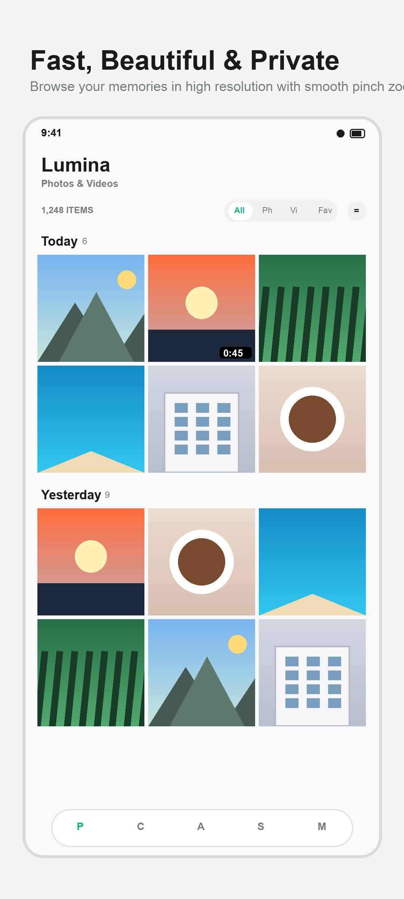
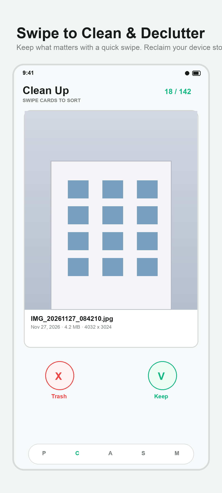
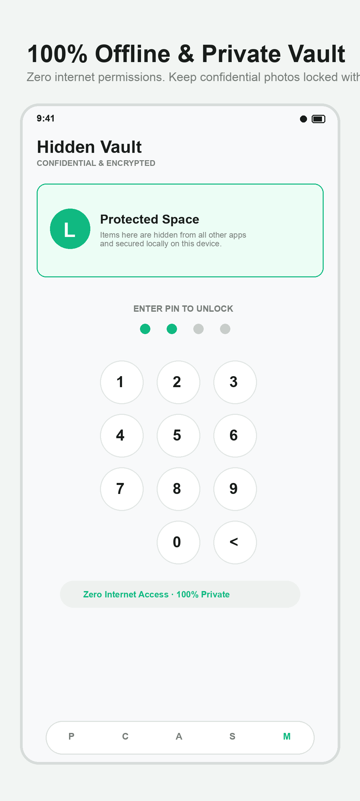

<p align="center">
  
</p>

<h1 align="center">Lumina</h1>

<p align="center">
  <b>Your memories, illuminated.</b><br>
  A blazing-fast, privacy-first, gesture-driven Android gallery built 100% with Kotlin & Jetpack Compose.
</p>

<p align="center">
  
  
  
  
  
  
  <a href="https://github.com/initeshjain"></a>
</p>

---

## App Screenshots

<p align="center">
  
  
  
</p>

---

## Table of Contents

- [Overview](#overview)
- [Key Features](#key-features)
  - [1. Pictures — Smart Timeline & Instant Search](#1-pictures--smart-timeline--instant-search)
  - [2. Hierarchical Time & Folder Explorer](#2-hierarchical-time--folder-explorer)
  - [3. Smooth Pinch-to-Zoom Grid with Live Physics](#3-smooth-pinch-to-zoom-grid-with-live-physics)
  - [4. Modern Comfy Fast-Scroll Scrollbar with Haptics](#4-modern-comfy-fast-scroll-scrollbar-with-haptics)
  - [5. Skeleton Shimmer Loading](#5-skeleton-shimmer-loading)
  - [6. Continuous Drag-to-Select Gestures](#6-continuous-drag-to-select-gestures)
  - [7. Albums & Collections](#7-albums--collections)
  - [8. Clean Up Hub — Hybrid ML Burst & Duplicate Engine](#8-clean-up-hub--hybrid-ml-burst--duplicate-engine)
  - [9. Swipe Tidy — Interactive Deck Sorting](#9-swipe-tidy--interactive-deck-sorting)
  - [10. Media Viewer & Gesture Controls](#10-media-viewer--gesture-controls)
  - [11. Live Text Scanner & OCR Selection ("T" Button)](#11-live-text-scanner--ocr-selection-t-button)
  - [12. Full-Featured Image Editor & Creative Studio](#12-full-featured-image-editor--creative-studio)
  - [13. Blemish & Spot Patch Eraser (Object Remover)](#13-blemish--spot-patch-eraser-object-remover)
  - [14. Advanced Video Player](#14-advanced-video-player)
  - [15. EXIF Details, GPS Maps Intent & Metadata Privacy Stripper](#15-exif-details-gps-maps-intent--metadata-privacy-stripper)
  - [16. Hidden Vault — 100% Offline PIN-Protected Storage](#16-hidden-vault--100-offline-pin-protected-storage)
  - [17. Unified "More" Hub & Inline Settings](#17-unified-more-hub--inline-settings)
  - [18. Trash Bin & Smart 4-Second Instant Undo Navigation](#18-trash-bin--smart-4-second-instant-undo-navigation)
  - [19. Themes & Modern Aesthetics](#19-themes--modern-aesthetics)
- [Privacy & Security Commitment](#privacy--security-commitment)
- [Architecture & Tech Stack](#architecture--tech-stack)
- [Building & Installation](#building--installation)
  - [Prerequisites](#prerequisites)
  - [Build Debug APK](#build-debug-apk)
  - [Build Release APK](#build-release-apk)
  - [Sign the Release APK](#sign-the-release-apk)
- [Author & Acknowledgments](#author--acknowledgments)

---

## Overview

**Lumina** is designed as a modern replacement for bloated, ad-ridden gallery apps. Built from the ground up using **Jetpack Compose** and **Material 3**, Lumina offers a fluid 120Hz browsing experience, responsive gesture navigation, and robust tools to declutter your photo library.

Most importantly, Lumina operates **100% offline**: the app does not request or possess the `android.permission.INTERNET` permission. Your personal photos, videos, and metadata never leave your physical device.

---

## Key Features

### 1. Pictures — Smart Timeline & Instant Search

The primary **Pictures** tab organizes your visual life with smart contextual timeline groupings and instant search:

- **Friendly Date Headings**: Automatically formats dates into natural language:
  - *Today*
  - *Yesterday*
  - *26 May* (current year)
  - *26 May 2023* (previous years)
- **Top Timeline Pills**: Switch between timeline zoom levels with a single tap:
  - `Days`: Micro-level grouping by day.
  - `Months`: Mid-level grouping by month (e.g. *May 2024*).
  - `Years`: High-level overview by year (e.g. *2024*, *2023*).
- **Fast Media Filters**: Filter the grid dynamically with pills for `All`, `Photos`, `Videos`, or `Favorites`.
- **Live Search**: Tap the search icon to instantly filter pictures and videos by file name in real time without lag.
- **Multi-criteria Sorting**: Sort by *Date*, *Name*, or *File Size* in both *Ascending* and *Descending* order.

### 2. Hierarchical Time & Folder Explorer

Navigate your entire visual memory hierarchically through dedicated time folders:
- **Year Folders**: Visual root view displaying folder cards for every year with cover thumbnails and photo counts.
- **Top Dual Options inside Folders**:
  - `All in [Year]`: Displays all photos and videos of that year in a fluid, pinchable grid.
  - `Group`: Organizes the year into interactive **Month Folders** (January, February, March...).
- **Month Deep Dive**:
  - `All in [Month]`: View every image of that month in a single flat grid.
  - `Group`: Breaks down the month into **Date Folders** for each day.
- **Date Folders**: Jump into any single day to see photos taken on that exact date.
- **Deep System Back Navigation**: Integrated with Android's predictive `BackHandler` and in-app breadcrumbs to step back through `Date` $\rightarrow$ `Month` $\rightarrow$ `Year` $\rightarrow$ `Root`.

### 3. Smooth Pinch-to-Zoom Grid with Live Physics

Fluidly scale thumbnail density using two-finger pinch gestures across the primary **Pictures** timeline, album views, and all time folder views:
- **Continuous Visual Scaling**: Live `graphicsLayer` scale tracking expands or contracts the grid smoothly under your fingers during gestures.
- **Dynamic Centroid Pivot**: Anchors the focal point (`TransformOrigin`) at the exact center between your two fingers.
- **Spring Return Physics**: Integrated spring dynamics (`Spring.DampingRatioLowBouncy`) snap the grid smoothly into the target column count upon release.
- **1 to 5 Columns**: Choose between immersive single-column full-width feeds up to 5-column ultra-dense overviews for rapid skimming.
- **Zero Scroll Conflict**: Single-finger vertical gestures remain 100% native and unconsumed, guaranteeing silky 120Hz scrolling.
- **Floating Density Feedback**: Animated pill badge confirms column count on each pinch gesture and persists preferences in SharedPreferences.

### 4. Modern Comfy Fast-Scroll Scrollbar with Haptics

Effortlessly scrub through large collections in seconds:
- **Comfy 42dp Touch Lane**: Effortless thumb grabbing on the right edge of the screen without pixel hunting.
- **Haptic Feedback**: Subtle vibration tick when grabbing the scrollbar thumb for tactile feedback.
- **Dynamic Auto-Fade**: Smoothly fades in during active scrolling or dragging, and automatically fades out after 1.4 seconds of inactivity.
- **Interactive Thumb Bar**: Expands in width and glows with Lumina's emerald accent color when touched or dragged.
- **Floating Date Preview Bubble**: Real-time elevated pill bubble tracks alongside your thumb, showing the formatted month and year (e.g. `Nov 2024`) with strict single-line text formatting to prevent awkward wrapping.

### 5. Skeleton Shimmer Loading

- **Silky Shimmer Placeholders**: Animated linear gradient skeleton loading placeholders appear while media decodes and loads from disk.
- **Zero Layout Shifts**: Preserves exact thumbnail aspect ratios without jarring layout reflows.
- **Crossfade Transitions**: 200ms alpha crossfade once media finishes decoding, with broken-image fallback indicators if a file is damaged.

### 6. Continuous Drag-to-Select Gestures

- **Continuous Range Selection**: Long-press any photo to enter selection mode, then smoothly drag across rows and columns to select or deselect large ranges of photos without repeated tapping.
- **Floating Contextual Action Bar**: Elevates when items are selected with instant batch actions:
  - *Favorite / Unfavorite*
  - *Share* via system share sheet
  - *Move to Album*
  - *Hide in Vault* (PIN-protected)
  - *Delete* (batch trash via Scoped Storage)

### 7. Albums & Collections

- **Dual-Tab Switcher**: Seamlessly toggle between `Device Albums` and `Year Folders`.
- **Automatic Folder Discovery**: Automatically indexes albums directly from device storage (e.g., Camera, Screenshots, WhatsApp, Downloads, Instagram).
- **Dedicated Favorites Album**: One-click access to all starred media across all folders.
- **Per-Album Deep-Dives**: Tap any album card to open an isolated grid filtered exclusively to that album with full pinch-to-zoom and fast-scroll support.

### 8. Clean Up Hub — Hybrid ML Burst & Duplicate Engine

Tidying up cluttered galleries shouldn't be guesswork. Lumina includes an on-device, 100% offline 3-stage Hybrid ML engine to identify burst sequences and redundant duplicates:

1. **Step 1: EXIF Timestamp Windowing**: Clusters photos taken in rapid succession within a $\le 3$-second window.
2. **Step 2: 64-bit Gradient Difference Hashing (`dHash`)**: Generates an 8-byte visual hash comparing adjacent pixel luminance gradients to confirm visual similarity independent of lighting.
3. **Step 3: 2D Discrete Laplacian Edge Variance**: Applies a 2D discrete Laplacian filter $\begin{bmatrix} 0 & -1 & 0 \\ -1 & 4 & -1 \\ 0 & -1 & 0 \end{bmatrix}$ over downsampled $128 \times 128$ bitmaps ($\approx 3\text{ ms}$ processing time, zero UI frame drops) to measure optical focus and edge sharpness.

- **`⭐ Best Shot` Auto-Crowning**: The sharpest photo in each burst sequence is crowned with a gold badge.
- **Sharpness Score Badges**: Inferior/shaky shots receive relative blurriness indicators (e.g., `Blurry (42%)`).
- **One-Tap Preselection**: Blurry and redundant duplicates are automatically pre-selected in `recommendedDeleteIds` so you can declutter entire burst series in a single tap.

### 9. Swipe Tidy — Interactive Deck Sorting

Lumina turns manual decluttering into an enjoyable card-stack interaction:

- **Swipe Right**: Keep the photo.
- **Swipe Left**: Move the photo into the recoverable Trash Bin.
- **Gesture Guard**: Bottom 18% of the screen is guarded against accidental system navigation gestures.
- **Album Filtering**: Select a specific album (e.g., *Screenshots* or *Downloads*) to clean up one collection at a time, or tidy your entire library.
- **Direct Action Buttons**: Don't want to swipe? Use the large, accessible bottom action buttons for quick one-tap decisions.

### 10. Media Viewer & Gesture Controls

Viewing memories should feel natural and effortless:

- **Two-Finger Pinch-to-Zoom**: Fluid zoom from $1.0\times$ up to $5.0\times$ with smooth panning across both images and videos.
- **Seamless Pager Swiping**: Single-finger horizontal swipes automatically transition between the previous and next media items when zoom scale is at $1.0\times$.
- **Double-Tap Quick Zoom**: Double-tap any photo to toggle between fitted view and $2.5\times$ zoom.
- **Tap to Hide Controls**: A single tap hides all top and bottom overlays into an immersive, edge-to-edge cinema mode with high-contrast frosted backing.
- **Swipe-Up Quick Discard**: Drag upward on any image to initiate a delete gesture, accompanied by a centered red indicator for immediate visual confirmation.

### 11. Live Text Scanner & OCR Selection ("T" Button)

Extract, select, and copy text directly from any picture using on-device optical character recognition:
- **Samsung-Style "T" Button**: A sleek floating pill button with an animated OCR scan icon appears in the bottom corner of the photo viewer whenever viewing images.
- **100% Offline via Play Services**: Powered by Google Play Services ML Kit (`play-services-mlkit-text-recognition`), adding **0 MB** of APK bloat while running entirely on-device with zero network communication.
- **Selectable Bottom Sheet**: Tapping the "T" button scans the image and slides up a clean sheet with:
  - Full text preview with interactive cursor selection.
  - Line and character count indicators.
  - **Copy All** to clipboard in a single tap with haptic confirmation.
  - **Share** extracted text directly to any messaging or note-taking app.

### 12. Full-Featured Image Editor & Creative Studio

A complete, non-destructive editing suite right inside Lumina:
- **Precision Crop & Geometry**:
  - Freeform cropping with draggable corner handles and rule-of-thirds grid overlay.
  - Aspect ratio presets: `Free`, `1:1 (Square)`, `4:5 (Instagram Portrait)`, `4:3`, `3:2`, `16:9`, and `9:16 (Stories/Reels)`.
  - 90° clockwise rotation and horizontal/vertical mirroring.
- **Live GPU Color Grading**:
  - Real-time `ColorMatrix` adjustments with instant interactive sliders:
    - *Brightness* ($-0.5$ to $+0.5$)
    - *Contrast* ($0.5\times$ to $2.0\times$)
    - *Saturation* ($0.0\times$ B&W to $2.0\times$ hyper-saturated)
    - *Warmth* (Cool blue $\leftrightarrow$ Golden amber tinting)
    - *Vignette* (Subtle edge-falloff radial darkening)
- **1-Tap Aesthetic Filters**:
  - `Original`, `Vivid` (punchy contrast), `Sunset` (warm golden-hour glow), `Nordic` (desaturated cinematic), `OLED B&W` (deep monochrome), `Sepia` (vintage warmth), `Matte` (lifted film shadows), and `Teal & Orange` (modern cinema look).
- **Freehand Markup & Doodling**:
  - Smooth vector brush strokes with adjustable stroke width (4dp to 32dp).
  - Material 3 color swatches (White, Amber, Emerald, Coral, Cyan, Dark).
  - Eraser mode and multi-step Undo stack.
- **Hold-to-Compare**: Press and hold the "Compare" pill to toggle instantly between your current edit and the unedited original.
- **Non-Destructive Export**: Edits are safely saved as a high-resolution new copy into `Pictures/Lumina` using Scoped Storage, leaving your original photo untouched.

### 13. Blemish & Spot Patch Eraser (Object Remover)

Clean up unwanted spots, sensor dust, watermarks, or blemishes directly within the editor:
- **Localized Boundary Diffusion**: Utilizes a fast on-device $4^{\text{th}}$-power inverse distance weighted boundary texture synthesis algorithm.
- **Sub-15ms Execution**: By restricting calculations to the exact bounding box of the eraser stroke rather than the entire canvas, object removal runs in $< 15\text{ ms}$ in pure Kotlin without NDK overhead or battery drain.
- **Unlimited Undo Stack**: Retains snapshot history allowing you to undo or redo brush strokes effortlessly.

### 14. Advanced Video Player

Built on Google's **Media3 ExoPlayer** engine:

- **Modern Playback Controls**: Frosted dark glass controls that auto-hide during playback.
- **±10-Second Quick Seek**: Jump forward or backward by 10 seconds with dedicated seek buttons.
- **Live Scrubbing Slider**: Smooth time scrubbing accompanied by current and remaining time indicators (`mm:ss`).
- **Playback Speed Selector**: Speed up or slow down videos with instant presets:
  - `0.5x` (Slow Motion)
  - `1.0x` (Normal)
  - `1.25x`
  - `1.5x`
  - `2.0x` (Fast Forward)
- **Instant Mute Toggle**: Quickly mute or unmute audio without changing your device's master volume.

### 15. EXIF Details, GPS Maps Intent & Metadata Privacy Stripper

Tap the **"i"** (Info) icon on any photo or video to open the Media Details Sheet:

- **Comprehensive File Info**: File name, formatted file size (KB / MB / GB), resolution dimensions ($W \times H$), creation date & time, MIME type, and local folder path.
- **Camera EXIF Data**: Camera manufacturer & model, lens specifications, aperture ($f$-stop), exposure time, ISO sensitivity, focal length, flash status, and GPS coordinates.
- **Open in Maps Intent**: When EXIF GPS coordinates exist, a prominent button launches the location directly in your device's preferred navigation app (e.g. Google Maps or OpenStreetMap).
- **In-Place File Renaming**: Rename files directly within MediaStore with immediate UI updates.
- **Strip EXIF / Privacy Clean**: Strip location coordinates (latitude/longitude), camera model, and identifying metadata with a single tap before sharing photos to social media or messaging apps.

### 16. Hidden Vault — 100% Offline PIN-Protected Storage

A zero-cloud, hardware-accelerated private safe built directly into Lumina:

- **4-Digit Secure PIN**: Secured via salted SHA-256 hashing stored strictly in local private storage.
- **Animated Numeric Keypad**: Interactive tactile dialer with spring-animated PIN dots and error-shake feedback.
- **Stealth Protection**: Photos hidden in the vault are completely excluded and filtered out from the main Pictures grid, Albums, and Clean Up views.
- **One-Tap Actions**: Easily hide photos from the Media Viewer or multi-select action bar, and unhide or permanently delete items inside the vault.

### 17. Unified "More" Hub & Inline Settings

Lumina consolidates management tools and preferences into a single, cohesive **"More"** dashboard without nested page hopping:

- **Security & Vault**: Direct cards for the PIN-protected *Hidden Vault* and *Trash Bin*.
- **Appearance & Display**: Inline segmented selector for theme mode (`System`, `Light`, `Dark`) and quick picker for default grid density (`2`, `3`, `4`, or `5` columns).
- **Storage & System**: Instant MediaStore permissions overview and direct developer feedback contact.
- **About Lumina**: Version and project details.

### 18. Trash Bin & Smart 4-Second Instant Undo Navigation

- **Smart 4-Second Undo Snackbar**: Whenever a photo is discarded in the Media Viewer, an interactive snackbar appears for 4 seconds:
  - Tapping **Undo** from the viewer restores the photo to storage **and immediately navigates back to focus on that restored photo in the viewer**.
  - Restoring items from inside the *Trash Bin* restores them silently in place without disrupting your viewing.
- **Reverse Chronological Order**: Your most recently discarded photos and videos always appear at the top of the bin.
- **Single-Prompt Deletion**: Deleting an item triggers the native **Android Scoped Storage prompt** once, keeping the process secure, compliant, and streamlined.

### 19. Themes & Modern Aesthetics

- **Dynamic Theme Modes**:
  - `System Default`: Follows your Android OS dark/light schedule.
  - `Dark Mode`: Pure dark background (`#0F1113`) optimized for OLED screens.
  - `Light Mode`: Crisp, clean paper background (`#F7F8FA`).
- **Standard Palette**: Emerald mint accents (`#1B6C53` / `#4FD8A2`), deep graphite typography, and soft glass card surfaces.

---

## Privacy & Security Commitment

| Feature | Lumina | Typical Gallery Apps |
| :--- | :---: | :---: |
| **Internet Access (`android.permission.INTERNET`)** | ❌ **No (Zero Network)** | ✅ Yes (Sends Analytics/Ads) |
| **Cloud Sync Tracking** | ❌ **None** | ✅ Account Mandatory |
| **Location Data Handling** | 🔒 **On-Device Only** | ⚠️ Often Uploaded |
| **One-Tap EXIF Stripping** | ✅ **Built-in** | ❌ Rare / Requires Pro |
| **Scoped Storage Compliant** | ✅ **Android 11–15** | ⚠️ Legacy Workarounds |

---

## Architecture & Tech Stack

```text
app/
├── src/main/java/com/swipegallery/app/
│   ├── MainActivity.kt          # Single-activity entry point with edge-to-edge system bars
│   ├── GalleryApp.kt            # Core root composable, navigation state, and MediaStore query engine
│   ├── GalleryScreens.kt        # Pictures grid, Albums, Unified More hub, and modern fast scrollbar
│   ├── GalleryModels.kt         # Data classes (Photo, MediaSort, MediaGroup, Page, DuplicateCluster)
│   ├── GalleryTheme.kt          # Material 3 ColorScheme, dynamic typography, and dark/light palettes
│   ├── ImageEditorScreen.kt     # Full image editor: crop, color grading, filters, doodles & blemish eraser
│   ├── LiveTextScanner.kt       # On-device Live Text (OCR) scanning via Google Play Services ML Kit
│   ├── VaultScreen.kt           # PIN setup/unlock, encrypted vault grid, and security actions
│   ├── CleanUpScreen.kt         # Swipe Tidy deck + Hybrid ML burst & duplicate clustering (dHash + Laplacian)
│   ├── MediaDetailsHelper.kt    # EXIF extraction, in-place renaming, and metadata stripping
│   ├── MediaDialogs.kt          # Sort & Group dialog, Move dialog, and GPS Open in Maps intent
│   ├── VideoPlayer.kt           # Media3 ExoPlayer custom playback controls and surface
│   ├── SettingsScreen.kt        # Standalone settings dialogs and developer profile
│   └── SelectionUi.kt           # Multi-select drag gestures and top/bottom action bars
└── src/main/res/                # Vector drawables, mipmap launcher icons, and styles
```

- **Language**: 100% Kotlin 2.0 with Kotlin Coroutines & Flow
- **UI Framework**: Jetpack Compose (BOM 2024.12.01) + Material 3
- **Media Engine**: Android MediaStore ContentResolver + Scoped Storage (`MediaStore.createDeleteRequest`, `createWriteRequest`)
- **Video Engine**: `androidx.media3:media3-exoplayer:1.5.0`
- **Image Pipeline**: `io.coil-kt:coil-compose:2.7.0` (with hardware bitmap caching and video frame decoders)
- **Live Text / OCR Engine**: `com.google.android.gms:play-services-mlkit-text-recognition:19.0.1` (0 MB APK footprint, offline)
- **Metadata**: `androidx.exifinterface:exifinterface:1.3.7`

---

## Building & Installation

### Prerequisites

- **JDK**: Java Development Kit 17 (e.g. OpenJDK 17, Eclipse Temurin)
- **Android SDK**: Build Tools `34.0.0` or `35.0.0`, Platform SDK `35`
- **Gradle**: Gradle 8.9 (handled automatically via `./gradlew`)

Ensure `local.properties` specifies your Android SDK path:
```properties
sdk.dir=/path/to/android-sdk
```

### Build Debug APK

To compile and produce an installable debug APK:

```bash
./gradlew assembleDebug
```

Output location:
```text
app/build/outputs/apk/debug/app-debug.apk
```

Install on a connected device via ADB:
```bash
adb install -r app/build/outputs/apk/debug/app-debug.apk
```

### Build Release APK

To compile the release APK with full R8 optimization, minification, and resource shrinking:

```bash
./gradlew assembleRelease
```

Output location:
```text
app/build/outputs/apk/release/app-release.apk
```

---

### Sign the Release APK

Before distributing or installing the release build on a physical device, sign it with your own private release key using `apksigner`.

#### 1. Generate a Release Keystore (One-Time)
Run this command in your terminal (do not share your `.jks` file or commit it to version control):

```bash
keytool -genkey -v \
  -keystore lumina-release-key.jks \
  -keyalg RSA \
  -keysize 2048 \
  -validity 10000 \
  -alias lumina_key
```

Follow the prompts to specify a secure password and certificate details.

#### 2. Sign with `apksigner`
Using `apksigner` from your Android SDK `build-tools`:

```bash
$ANDROID_HOME/build-tools/34.0.0/apksigner sign \
  --ks lumina-release-key.jks \
  --ks-key-alias lumina_key \
  --out app/build/outputs/apk/release/Lumina-release.apk \
  app/build/outputs/apk/release/app-release.apk
```

#### 3. Verify Signature
Confirm that the APK is signed and conforms to Android v2/v3 signing schemes:

```bash
$ANDROID_HOME/build-tools/34.0.0/apksigner verify --verbose app/build/outputs/apk/release/Lumina-release.apk
```

---

## Author & Acknowledgments

- **Creator & Developer**: [@initeshjain](https://github.com/initeshjain)
- **Project**: **Lumina** (`com.swipegallery.app`)

If you find Lumina helpful for keeping your photo library organized, feel free to star the repository and share it!
